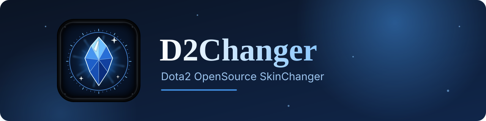
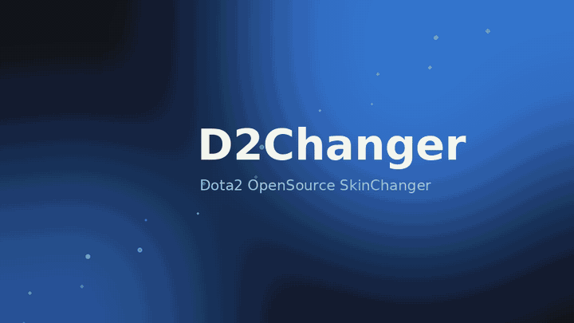

<div align="center">



# D2Changer

**Dota2 OpenSource SkinChanger**

Оригинал — [dota2modmanager.com](https://dota2modmanager.com/)

[](https://github.com/ryuson3/d267updater/releases/latest)
[](https://github.com/ryuson3/d267updater/releases)
[](#лицензия)

[**⬇ Скачать**](https://github.com/ryuson3/d267updater/releases/latest) · [Возможности](#возможности) · [Скриншоты](#скриншоты) · [Установка](#установка)

</div>

---

## Возможности

- **Косметика** — бесплатные слоты: курьер, вард, погода, загрузочный экран, анонсер и другие
- **Предметы героев** — наборы, стили, арканы, эффекты, камни Kinetic Gem
- **Эмблемы** — со своими эффектами атаки
- **Перекраска эффектов** — свой цвет гема (например, аркана Terrorblade)
- **Иконки способностей** — подмена картинок способностей
- **3D-превью** героя с надетыми предметами
- **Пресеты** — сохраняй и меняй наборы одним кликом
- **Автообновление** — новые версии ставятся сами
- Русский и китайский интерфейс, смена цвета темы

## Демо

<div align="center">



</div>

## Скриншоты

<div align="center">

| Косметика | Предметы героев |
|:---:|:---:|
|  |  |

| 3D-превью | Настройки |
|:---:|:---:|
|  |  |

</div>

## Установка

1. Открой страницу [Releases](https://github.com/ryuson3/d267updater/releases/latest).
2. Скачай `DotaModLauncher-Setup-….exe` (с автообновлением) или `DotaModLauncher-Portable-….exe` (без установки).
3. Запусти. Папка игры найдётся сама, если не нашлась — укажи `…\dota 2 beta\game`.
4. Выбери косметику и нажми **«Применить косметику»**, потом **«Играть»**.

> Portable-версия сама не обновляется: показывает ссылку на новый релиз.

## Сборка из исходников

```bash
npm install
npm start          # запуск
npm run dist       # сборка установщика и portable
```

## Благодарности

Окно «Косметика» собрано на коде [Dota 2 Mod Manager](https://github.com/TheFleece) (© 2026 TheFleece). Конструктор предметов героев — h6rd вместе с TheFleece. Таблица работающих арканов — [J0nathan550](https://github.com/J0nathan550). Это изменённая версия, не оригинальное приложение.

## Лицензия

GPL-3.0-or-later. Приложение не связано с Valve.
